  

<h1 align="center">Gabriel Santana <code>// PhaseSpider</code></h1>

  <strong>Security-focused software developer turning raw data and suspicious artifacts into useful signals.</strong>

  Computer Science @ University of Brasília &nbsp;·&nbsp; Python Automation &nbsp;·&nbsp; Malware Analysis &nbsp;·&nbsp; Threat Detection

  
  
  

## `// about`

I am a Computer Science undergraduate at the **University of Brasília (UnB)** building toward a career in cybersecurity. My background combines **Python automation and data workflows**, undergraduate research in **evolutionary computation**, and hands-on practice across security labs and CTF environments.

My current direction is deliberately close to the machine: **malware analysis, reverse engineering, threat detection, and security tooling**. I like projects that begin with noisy technical artifacts and end with something an analyst can actually use.

## `// current focus`

| Status | Focus | What I am doing |
|:--|:--|:--|
| `BUILDING` | **Security automation** | Developing PhaseSnare as a tested CLI for IOC extraction, validation, and structured output |
| `RESEARCHING` | **Malware analysis** | Exploring static and dynamic analysis, binary representation, and how obfuscation affects analysis |
| `PRACTICING` | **Hands-on security** | Working through Windows internals, reverse engineering, SOC, web security, and CTF labs |
| `STUDYING` | **Low-level systems** | Strengthening x86/x64, C/C++, operating systems, and computer architecture fundamentals |

## `// selected work`

| Project | Description | Signal |
|:--|:--|:--|
| **[PhaseSnare](https://github.com/Gabreeel/PhaseSnare)** | Python CLI that extracts and validates IOCs from logs and unstructured text, with JSON output and automated tests | `ACTIVE` |
| **[Malware Research Workspace](https://github.com/Gabreeel/estudo-tcc)** | Structured study and experimentation workspace spanning malware analysis, binary representation, machine learning, and reproducible research | `RESEARCH` |
| **[CTF Write-ups & Reports](https://github.com/Gabreeel/ctf-writeups-and-reports)** | Technical write-ups and formal reports from TryHackMe and Hack The Box practice | `LABS` |
| **[Evolutionary Fuzzing Notes](https://github.com/Gabreeel/fuzzing-evolutivo-notes)** | Research notes on fuzzing foundations, benchmarks, evolutionary approaches, and application domains | `NOTES` |

## `// technical toolkit`

**Core development**

**Security and systems**

## `// background`

- Nearly two years at **Banco do Brasil**, supporting management with Python automation, operational analysis, reports, dashboards, and data-driven workflows.
- Undergraduate research at **LARA/UnB**, working with genetic programming and evolutionary computation.
- Practical cybersecurity development through **Blue Team training, CTFs, TryHackMe, web security, and independent projects**.
- Native Portuguese speaker with **fluent English**.

## `// looking forward`

I am open to **internship, trainee, junior, and research opportunities** where I can contribute through cybersecurity, security-oriented software development, or technical automation — especially around SOC, malware analysis, threat detection, and offensive/defensive tooling.

  <a href="https://github.com/Gabreeel">GitHub</a>
  &nbsp;·&nbsp;
  <a href="https://tryhackme.com/p/PhaseSpider">TryHackMe</a>

  Build the tool. Understand the system. Follow the signal.

